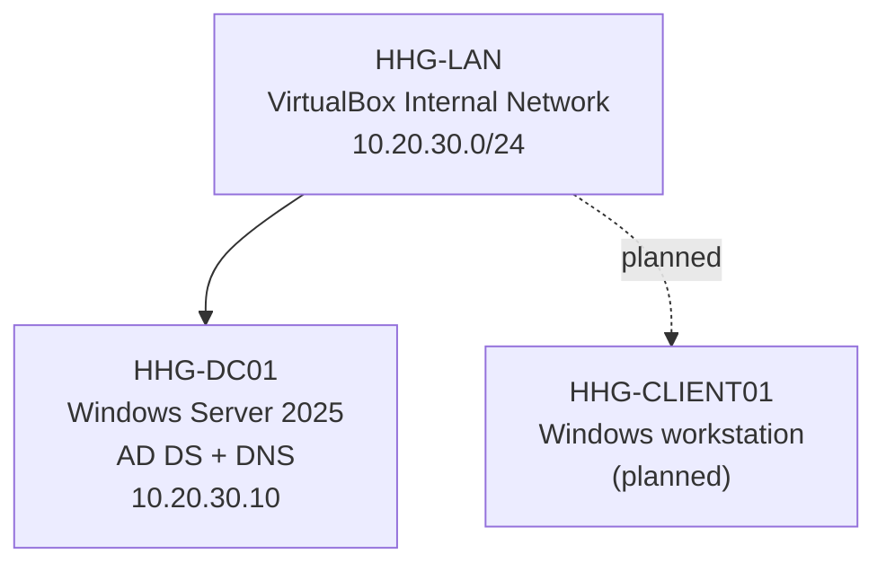

# Enterprise IT Infrastructure & Security Homelab

A hands-on **simulated small-business IT environment** built with VirtualBox, Windows Server, and an isolated virtual network. This project follows **Horizon Health Group (HHG)**, a fictional 35-employee outpatient healthcare organization, to practice infrastructure design, identity administration, troubleshooting, automation, and defensive security.

> **Scope:** This is a personal learning project, not a production environment, a real healthcare deployment, or professional IT employment. All business scenarios and employee data are fictional.

## Business problem

A growing organization needs centrally managed identities, dependable DNS, appropriate departmental access, repeatable IT operations, and tested recovery processes. Rather than deploying tools independently, this lab links each infrastructure decision to a business requirement and verifies its behavior.

## Architecture (current state)

**Isolation:** The lab uses a VirtualBox Internal Network with no default gateway. External access is not configured in the current environment.

## Verified milestones

- [x] Create VirtualBox VM `HHG-DC01` (2 vCPUs, 4 GiB RAM, 80 GB dynamically allocated disk, UEFI).
- [x] Install Windows Server 2025 Evaluation (Desktop Experience).
- [x] Rename the guest to `HHG-DC01` and configure `10.20.30.10/24` on `HHG-LAN`.
- [x] Capture a baseline snapshot before Active Directory deployment.
- [x] Promote the server as the first domain controller for `corp.horizonhealth.test`.
- [x] Confirm Active Directory and DNS with `Get-ADDomain`, `dcdiag`, `nltest`, and DNS lookups.
- [x] Create `HHG/Employees`, `HHG/Groups`, and `HHG/Workstations` organizational units.
- [x] Create departmental global security groups and provision a fictional employee account.
- [x] Verify the employee account has the appropriate departmental security group membership.
- [ ] Deploy and domain-join a Windows client; verify sign-in and access controls.
- [ ] Automate employee lifecycle administration with PowerShell.
- [ ] Add security monitoring, hardening, incident investigations, and recovery tests.

## Documentation

- [Architecture and design decisions](docs/architecture.md)
- [Implementation and validation](docs/implementation.md)
- [Case study: LDAP SRV lookup troubleshooting](docs/dns-troubleshooting.md)
- [Identity administration: OUs, groups, first employee](docs/identity-administration.md)

## Technology

**Virtualization:** Oracle VirtualBox (PC-based virtualization host)  
**Server:** Windows Server 2025 Evaluation, Active Directory Domain Services, DNS  
**Administration and validation:** PowerShell, Windows Server Manager, DNS tools  
**Portfolio:** Markdown, Git, GitHub

## Publication and security

No credentials, passwords, private keys, real patient information, or real employee data are published. VM disks, ISO images, and snapshots are excluded from version control. Commands and screenshots are reviewed before publication.

## Roadmap

**Identity administration → Domain-joined workstations → Access controls and Group Policy → PowerShell automation → Security monitoring and incident response → Backup and restoration.**

Each milestone will document intended behavior, actual test results, configuration decisions, and problems encountered.
